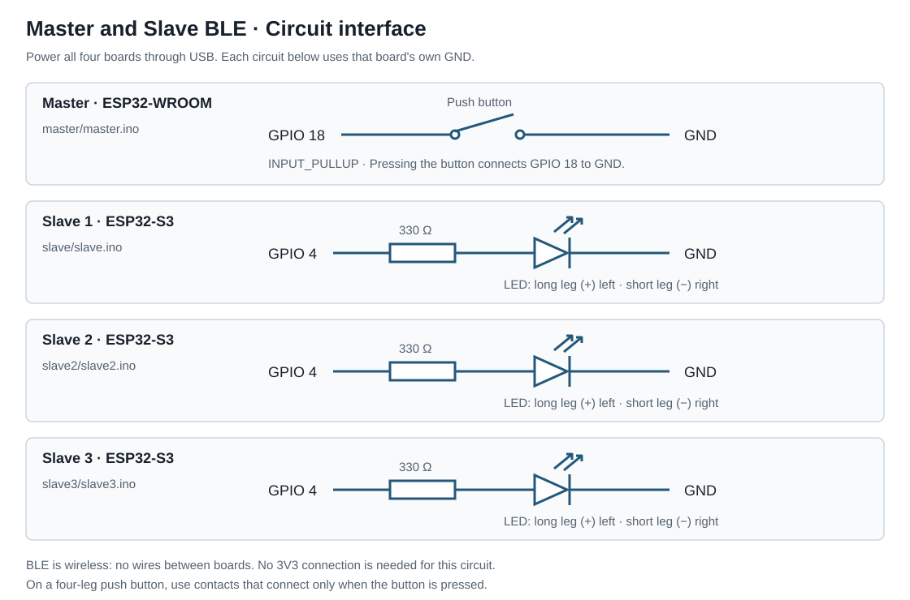
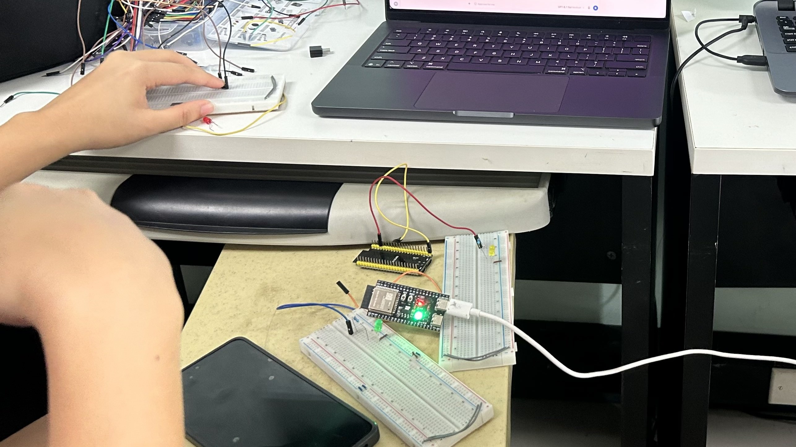
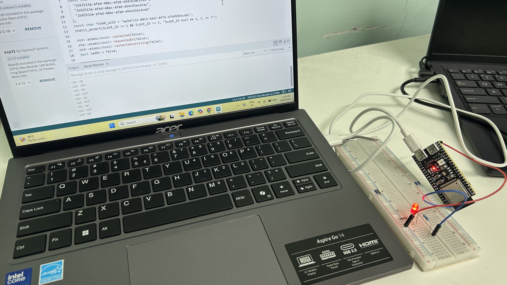
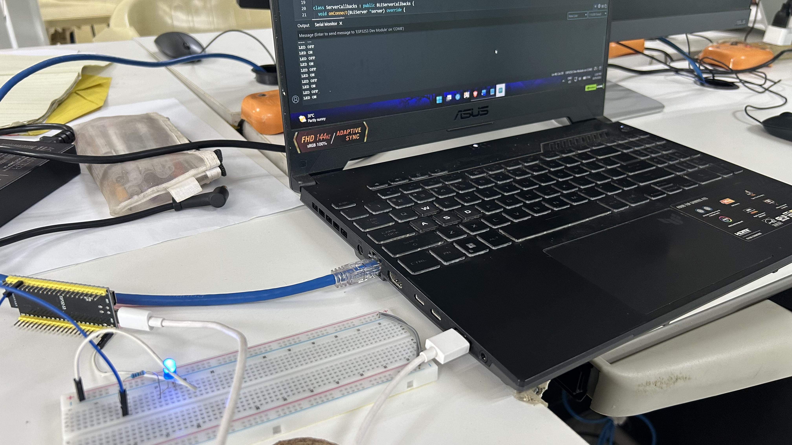
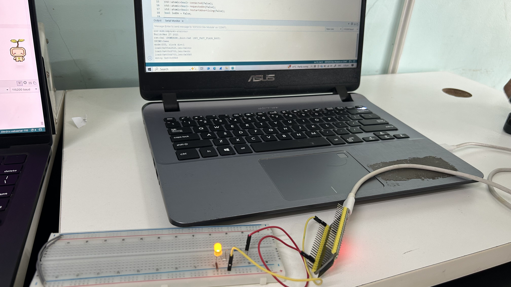
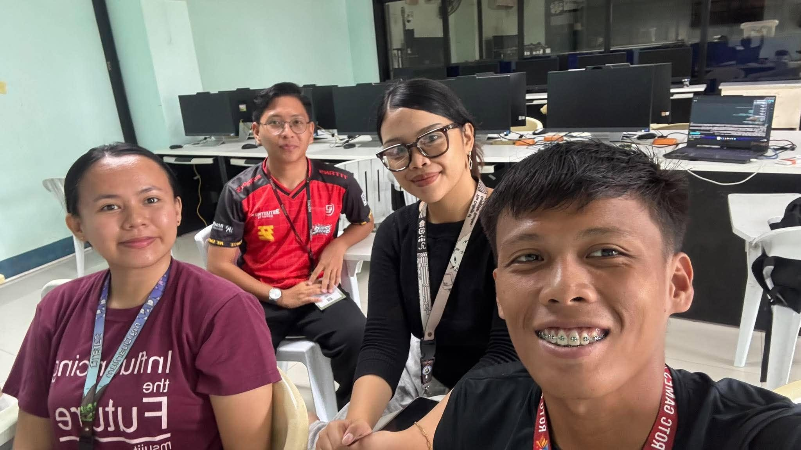
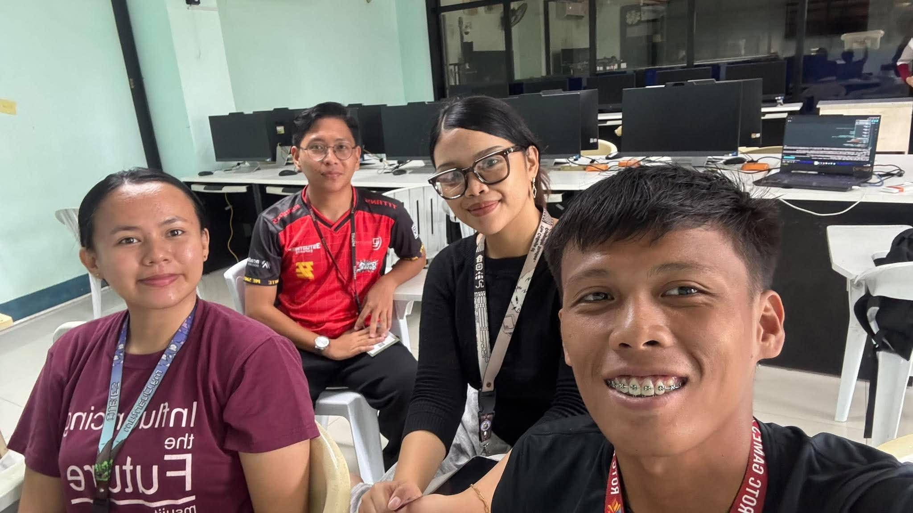

# Documentation

Our lab setup used one ESP32-WROOM master and three ESP32-S3 slaves.

## Circuit interface

Our master button uses GPIO 18, and each slave LED uses GPIO 4 with a 330 Ω resistor. We powered the boards through USB, with each circuit connected to its own board's GND.

## Setup photos

## Serial Monitor records

These moments in [our video](https://drive.google.com/file/d/1kcCcMRImZBvdQX3uAcBArwu-nvJS5H2h/view?usp=sharing) show the test:

- Around 0:25: the master shows slave connection messages and LED OFF commands.
- Around 0:42: the final demonstration begins.
- Around 1:01: a slave's Serial Monitor shows repeated LED ON and LED OFF messages.

## BLE addresses and UUIDs

Each board prints its BLE MAC address when it starts. Our master scans for the slave service UUIDs and connects using the detected BLE addresses. The slave names are BCA188 Slave 1, BCA188 Slave 2, and BCA188 Slave 3.

| Item | UUID |
| --- | --- |
| Slave 1 service | `2b92513e-afed-40ac-afa6-e54c63acdceb` |
| Slave 2 service | `2b92513e-afed-40ac-afa6-e54c63acdcec` |
| Slave 3 service | `2b92513e-afed-40ac-afa6-e54c63acdced` |
| LED characteristic, same on each slave | `ea3d7c32-0013-4447-8f7b-47b959b5cddc` |

We used `1` for ON and `0` for OFF.

## Demo

[Watch the system in operation](https://drive.google.com/file/d/1kcCcMRImZBvdQX3uAcBArwu-nvJS5H2h/view?usp=sharing)

The video is shared with anyone who has the link; no sign-in is required.

## Results

We tested the master button with three slaves. Holding the button turned the slave LEDs on, and releasing it turned them off. Our photos show the red, blue, and yellow LEDs lit. The final demonstration starts around 0:42, and the slave monitor near 1:01 shows ON/OFF responses.

## Team photos

## Lab response

**How is the stored and analyzed data used?**

Stored data can help identify patterns and guide decisions or automation. In our setup, we used the current button state to control the slave LEDs. Our programs do not store readings or analyze data.
